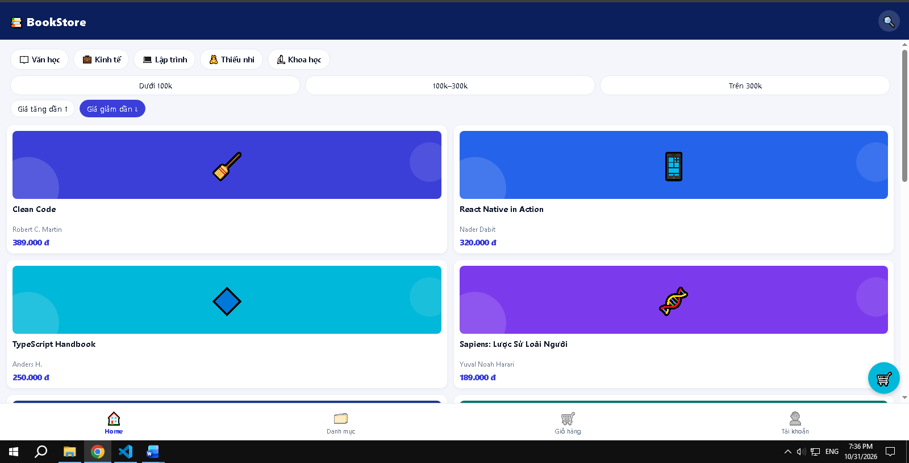

## Câu 1. Vì sao BookDetail đặt ở Stack?

Ở Stack thì màn Chi tiết phủ lên cả Tab Bar và tự có nút ← quay lại. Chi tiết là màn “đi sâu” từ một danh sách, không phải một mục ngang hàng.
Nếu đặt trong Tab thì nó thành một tab riêng, Tab Bar vẫn hiện và không có nút quay lại.

## Câu 2. Redux và useMemo.

Redux Toolkit dùng Immer: bạn “sửa” trên một bản nháp, Immer tự tạo state mới bất biến, nên state gốc không bị sửa trực tiếp.
Thử bỏ useMemo trong useCart (thay bằng tính thẳng bằng reduce): số hiển thị không đổi. Hậu quả chỉ là tổng bị tính lại ở mỗi lần render, giỏ lớn mới thấy tốn. useMemo chỉ để tối ưu, không quyết định đúng sai. Thử xong nhớ khôi phục.

## Câu 3. Promise.all và allSettled.

Khi getCategories() lỗi mà getBooks() thành công thì Promise.all lỗi cả nhóm, Home hiện ErrorView dù sách đã tải được.
Muốn tự thử: tạm đổi đường dẫn trong categoryService thành "/categoriesx" (sẽ 404), xem Home báo lỗi, rồi thử bản dưới và khôi phục lại.
Cách dùng Promise.allSettled (thay trong load() của Home):
tsx
const [b, c] = await Promise.allSettled([getBooks(), getCategories()]);
if (b.status === "rejected") throw b.reason;   // không có sách thì vẫn là lỗi
setBooks(b.value);
if (c.status === "fulfilled") setCategories(c.value);
Đánh đổi: phải tự xử lý lỗi cho từng phần (code dài hơn), và người dùng thấy giao diện thiếu chip danh mục mà không biết vì sao, trừ khi bạn thêm thông báo riêng.

## Câu 4. Debounce.

Đặt setTimeout thẳng trong onChangeText thì timer cũ không bị hủy, nên mỗi phím gõ vẫn gây một lần lọc (chỉ chậm đi chứ không được gộp lại).
Hàm dọn dẹp return () => clearTimeout(t) hủy timer cũ khi giá trị đổi, nên chỉ lần gõ cuối được áp dụng. Nó cũng tránh cập nhật state khi component đã bị gỡ (unmount).
## Câu 5. Code bổ sung
const visibleBooks = useMemo(() => {
  const filtered = filterBooks(books, { keyword: debouncedKeyword, categoryId, priceRange });
  if (sort === null) return filtered;
  return [...filtered].sort((a, b) => (sort === "asc" ? a.price - b.price : b.price - a.price));
}, [books, debouncedKeyword, categoryId, priceRange, sort]);
